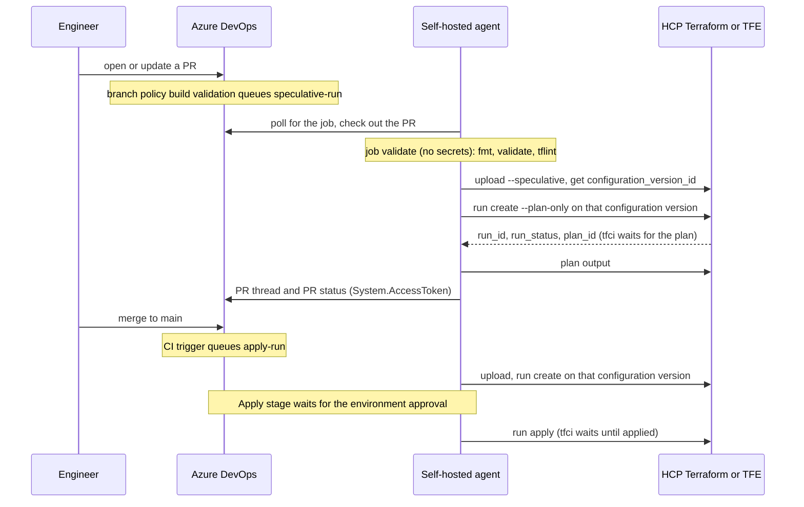

# tfc-workflow-azdo

Azure DevOps pipeline templates for HCP Terraform and Terraform Enterprise (TFE). They drive the API-driven (CLI-driven) workflow through [tfci](https://github.com/hashicorp/tfc-workflows-tooling), the HashiCorp CLI that uploads configuration and creates, reads and applies runs.

- A pull request gets a speculative plan of its own code. The pipeline posts the plan summary to the PR as a thread and sets a PR status.
- A merge to `main` uploads the code, creates a run, waits for an Azure DevOps environment approval, then applies that same run.

The same templates work against HCP Terraform and a private TFE with a private CA, internal images and no inbound connectivity. Only parameters change.

## How it runs



## Quick start

Reference this repository from your Terraform repository as a repository resource, pinned to a tag, and `extends` a pipeline template:

```yaml
resources:
  repositories:
    - repository: tfc
      type: git
      name: <Project>/tfc-workflow-azdo
      ref: refs/tags/v2.0.0

extends:
  template: templates/pipelines/speculative-run.yml@tfc
  parameters:
    workspace: my-app-dev
    organization: my-org
    hostname: tfe.example.internal
    pool:
      name: tfe-agents
```

The tag `v2.0.0` is created when this version is released. Until it exists, `ref: refs/tags/v2.0.0` does not resolve and the pipeline fails to start; pin a branch or commit for testing before then.

`hostname` is required on both pipeline templates (`app.terraform.io` for HCP Terraform). Add a Required template check on the variable groups and the PR agent pool ([setup.md](docs/setup.md#10-required-template-checks)), so a PR cannot swap the pipeline for its own and use the plan token.

Full examples:

- [`examples/azure-pipelines.pr.yml`](examples/azure-pipelines.pr.yml): the PR pipeline (`speculative-run.yml`).
- [`examples/azure-pipelines.main.yml`](examples/azure-pipelines.main.yml): the main pipeline (`apply-run.yml`).
- [`examples/smoke-test.yml`](examples/smoke-test.yml): a manual plan-only run that proves the agent, token and CA work.

## What you need

- **A self-hosted agent** that reaches TFE and Azure DevOps. In `docker` mode (the default) it needs Docker, bash, jq and curl 7.76 or later. In `native` mode it needs `tfci` on the PATH, bash, jq and curl, plus `terraform` and `tflint` when validation is on.
- **Two variable groups**: `tfc-plan` with a plan-permission team token and `tfc-apply` with an apply team token, each as the secret `TF_API_TOKEN`.
- **An environment** for the Apply stage, with an approval and a branch control check.
- **A branch policy** with build validation, so PRs run the PR pipeline.
- **Workspaces** using the CLI-driven workflow with Auto apply off.

[docs/setup.md](docs/setup.md) walks through all of it in order.

## Repository layout

```text
templates/
  pipelines/speculative-run.yml   extends template for PR builds
  pipelines/apply-run.yml         extends template for main: Plan stage, gated Apply stage
  steps/tfci.yml                  runs any tfci command (docker or native mode)
  steps/upload.yml                tfci upload, sets CONFIGURATION_VERSION_ID
  steps/run-create.yml            tfci run create, sets RUN_ID, RUN_STATUS, PLAN_ID, PLAN_STATUS, RUN_LINK
  steps/plan-output.yml           tfci plan output, writes a markdown summary
  steps/pr-comment.yml            PR thread and PR status through the Azure DevOps REST API
  steps/run-apply.yml             tfci run apply
  steps/validate.yml              terraform fmt, validate and tflint
examples/                         consumer pipelines and the smoke test
lab/azdo-agent/                   lab agent as a Kubernetes pod (native mode)
tests/                            local checks, run with tests/run.sh
docs/                             setup, security, reference, troubleshooting
```

## Docs

| Doc | What it covers |
| --- | --- |
| [setup.md](docs/setup.md) | End-to-end setup checklist: tokens, variable groups, environment, branch policy, agents, smoke test |
| [tfe-private-network.md](docs/tfe-private-network.md) | TFE with no inbound connectivity: agents inside the network, private CA, provider mirror |
| [internal-registry.md](docs/internal-registry.md) | Mirroring and pinning the images, native-mode agent images, moving tfci versions |
| [security.md](docs/security.md) | Threat model, token split, secret handling, residual risks |
| [reference.md](docs/reference.md) | Every template's parameters and output variables, generated from the templates |
| [troubleshooting.md](docs/troubleshooting.md) | Common failures with symptom, cause and fix |
| [CHANGELOG.md](CHANGELOG.md) | Release notes |
| [lab/azdo-agent/README.md](lab/azdo-agent/README.md) | The lab agent pod and its security model |

## Testing

```bash
bash tests/run.sh
```

It runs the template checker and its self-tests, the PR comment test against a fake Azure DevOps API, the examples against the local templates, a check that the tfci v1.4.0 and v1.5.0 command manifests match, shellcheck on every script in the templates, `terraform fmt`, `validate` and `tflint` on the fixture, and a check that [docs/reference.md](docs/reference.md) matches the templates. It needs Ruby, shellcheck and Terraform; tflint is optional.

## What changed in v2

v2 is a rebuild. Runs now plan the PR's own code, tokens are split between plan and apply, TFE with a private CA and internal images is supported, and the v1 `pipeline-templates/` and `tasks/` folders are gone. See [CHANGELOG.md](CHANGELOG.md).
