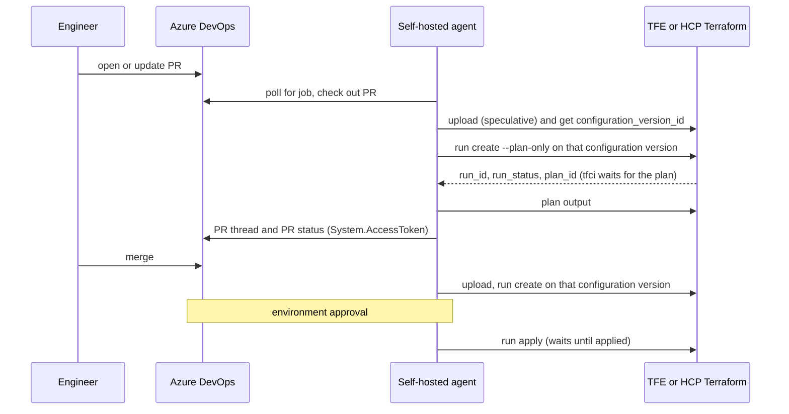

# tfc-workflow-azdo v2: design

Date: 2026-11-15. Owner: David Joo. Branch: `djoo/modernise`.

## Goal

Azure DevOps pipeline templates that drive HCP Terraform or Terraform Enterprise through the API with `tfci`, and that actually work: a pull request gets a speculative plan of its own code, posted back to the PR by the pipeline; a merge to main plans, waits for approval, then applies the same run.

They must also work for a regulated customer pattern:

- Terraform Enterprise is private, with no inbound connectivity. Nothing calls into it from the internet.
- Pipeline agents are self-hosted inside the customer network.
- Images come from an internal registry, pinned.
- TFE uses a private CA.
- Plan and apply use separate, short-lived team tokens.

## Success criteria

1. A PR pipeline uploads the PR's code as a speculative configuration version, creates a plan-only run **on that configuration version**, and posts a summary (add, change, destroy, run link) as a PR thread plus a PR status.
2. A main pipeline uploads, creates a run on that configuration version, stops at an Azure DevOps environment approval, then applies that run. Errored, canceled or discarded runs fail the pipeline.
3. The same templates work against HCP Terraform and Terraform Enterprise (hostname, private CA, internal image) by parameters only.
4. No secret appears on a command line, in a script body or in logs.
5. Local tests catch every class of defect found in the 2026-11-15 review (below), and run with one command.
6. Proven end to end in Azure DevOps against the lab TFE 2.1.1, with an agent running inside the lab network.

## Review findings this design fixes (2026-11-15, three reviewers, verified against tfci v1.4.0 and v1.5.0 source)

| Defect | Fix in v2 |
|---|---|
| `run create` never got `--configuration_version`, so PR plans ran on main's code | Upload with `--json`, pass `configuration_version_id` to `run create` |
| Wrong flags and fields (`--format=json`, `.data.attributes.status`, `workspace list`) | Only real tfci v1.4.0 commands and flags, checked by a test |
| Run ID scraped with a regex that never matches; `set +e` hid failures | `--json` plus `jq`, `set -euo pipefail` everywhere |
| Poll loops duplicating what `run create` and `run apply` already do | Removed. tfci blocks until a terminal state; `TF_MAX_TIMEOUT` bounds it |
| `${{ if }}` inside script strings; runtime macros into boolean template parameters | Compile-time values inlined (`--plan-only=${{ parameters.planOnly }}`); pipeline parameters for booleans |
| `terraform:light` with an extra `terraform` argument | Pinned image, correct entrypoint use |
| Token on the docker command line | `env:` mapping and `docker run -e TF_API_TOKEN` (name only) |
| One token for PR and apply | Two variable groups: plan token for PRs, apply token behind approval and branch control |
| No TFE support | `hostname`, `caBundle`, `image` parameters |
| Unpinned images, lock file ignored | Pinned tags, image is a parameter, `.terraform.lock.hcl` committed in fixtures |
| PR metadata expanded into bash | User-controlled values only through `env:` and quoted shell variables |
| Docs promising features that do not exist, user tokens, `set -x` | Docs rewritten from the code; team tokens; a security section |
| `pr:` trigger ignored by Azure Repos | Documented: PR builds come from branch-policy build validation |
| `update-best-practices.sh` overwrites templates when run | Deleted |

## Design

### Run flow



### Layout

```text
templates/
  steps/tfci.yml           one wrapper that runs any tfci command (docker or native mode)
  steps/upload.yml         upload --json, sets CONFIGURATION_VERSION_ID
  steps/run-create.yml     run create --json, sets RUN_ID, RUN_STATUS, PLAN_ID, RUN_LINK
  steps/plan-output.yml    plan output --json, writes a markdown summary
  steps/pr-comment.yml     PR thread and PR status through the Azure DevOps REST API
  steps/run-apply.yml      run apply --json
  steps/validate.yml       terraform fmt -check, validate, tflint (pinned image)
  pipelines/speculative-run.yml   extends template for PR validation builds
  pipelines/apply-run.yml         extends template for main: plan stage, gated apply stage
examples/
  azure-pipelines.pr.yml, azure-pipelines.main.yml   consumer pipelines, templates pinned by tag
lab/
  azdo-agent/               Kubernetes manifests: Azure DevOps agent pod with tfci copied in
tests/
  fixtures/random/          the old terraform/ sample, fixed
  check_templates.rb        static checks over all YAML
  tfci-v1.4.0-commands.txt  real tfci commands and flags, from source
  run.sh                    runs every local check
docs/  setup, tfe-private-network, internal-registry, security, reference, troubleshooting
CHANGELOG.md, progress.md
```

### Key decisions

- **One tfci wrapper.** Every tfci call goes through `steps/tfci.yml`. It owns the image, hostname, CA bundle, token handling and execution mode. Changing the CLI or its version later means changing one file.
- **Two execution modes.** `docker` (default): `docker run` the pinned image, for VM agents with Docker such as a customer's scale-set agents. `native`: call `tfci` on the agent's PATH, for agents that run as pods without Docker. The lab uses `native`.
- **No polling.** `tfci run create` waits for the plan to reach a terminal state and `tfci run apply` waits for the apply. Both exit non-zero on errored, canceled or discarded runs.
- **Consumers extend, not copy.** Consumer pipelines reference this repo through `resources: repositories` pinned to a tag and `extends: template: templates/pipelines/...@tfc`.
- **PR feedback is the pipeline's job.** With no ingress, TFE cannot post to the PR. The pipeline posts a thread and a status with `System.AccessToken`. The build service needs "Contribute to pull requests".
- **Secrets.** Only through `env:`. Two variable groups: `tfc-plan` (plan-permission team token, used by PR builds) and `tfc-apply` (apply token, protected by pipeline permissions, branch control on main and an approval).

### Lab end to end (lab, a lab tenant)

- Azure DevOps agent runs as a pod in the existing lab AKS cluster (namespace `azdo-agents`). An init container copies `tfci` from the pinned `hashicorp/tfci` image. No new VM or node, so no new compute for EDR (HC-COMPUTE-011); the existing nodes are already on the EDR list.
- The agent reaches TFE at `tfe.lab.internal` on the private network with the lab CA, and polls Azure DevOps outbound. Nothing calls in.
- David provides: the Azure DevOps organisation and project, the agent pool, the agent registration PAT (he creates the Kubernetes secret himself), the TFE team tokens (he enters them into the variable groups). Claude never handles those values.

## Testing

- `tests/run.sh`: YAML parse; template cross-check (parameters passed vs declared, no `$()` into boolean or number parameters, no `${{ if` inside script strings, no `../` template paths, no `:latest`, no `$(SECRET)` inside scripts, `set -euo pipefail` in every bash script); every tfci command and flag used exists in the v1.4.0 manifest; shellcheck on extracted scripts; `terraform fmt -check`, `validate` and `tflint` on the fixture.
- Each check is written first against the old templates and must fail there.
- End to end: PR pipeline and main pipeline in Azure DevOps against the lab TFE.

## Out of scope

- tfci's own code. Its upload command stays the way code reaches TFE.
- GitHub or GitLab. Azure DevOps only.
- Policy authoring. Policy results show in the run; the pipeline fails when a hard-mandatory policy fails.

## Assumptions

- Azure DevOps Services (cloud), Azure Repos Git.
- tfci v1.4.0 is the pinned default: it is the newest published image, and v1.5.0's command code is identical.
- `jq`, `bash` and `curl` are on the agent. Docker only in `docker` mode.
