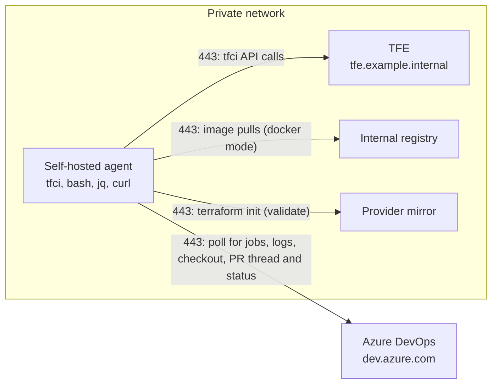

# TFE on a private network

This is the pattern for a Terraform Enterprise that nothing on the internet can reach: no inbound rules, a private hostname and a private CA.

## The pattern

- **Agents sit inside the network.** Self-hosted Azure DevOps agents run in the same network as TFE, or one that routes to it. They open every connection themselves: they poll Azure DevOps outbound for jobs, and they call the TFE API on its private address.
- **Nothing calls in.** Azure DevOps never connects to the agents or to TFE.
- **The pipeline posts the plan to the PR.** A TFE VCS integration or webhook would need Azure DevOps to call TFE, or TFE to receive events from outside. Neither is possible here. Instead the PR pipeline reads the plan with `tfci plan output` and posts a thread and a PR status itself, through the Azure DevOps REST API, outbound from the agent ([`pr-comment.yml`](../templates/steps/pr-comment.yml)).



Every arrow starts at the agent. TFE needs no inbound rule from outside the network.

## Hostname

Set `hostname` on the pipeline template to the TFE hostname, for example `tfe.example.internal`. It reaches tfci as `TF_HOSTNAME` ([`tfci.yml`](../templates/steps/tfci.yml)). `hostname` is required and has no default, so the token only goes to a host you named. For HCP Terraform set `app.terraform.io`.

## Private CA

There are two CA parameters because two different programs read them in two different ways.

### `caBundle`: tfci calls to TFE

`caBundle` is an absolute path on the agent to a PEM file with the TFE CA. The CA alone works; a full bundle also works.

[`tfci.yml`](../templates/steps/tfci.yml) puts the file in its own directory and points `SSL_CERT_DIR` at that directory:

- docker mode: the file is mounted read-only at `/tfci/ca/tfe-ca.pem` and the container gets `SSL_CERT_DIR=/tfci/ca`.
- native mode: the file is copied to `$(Agent.TempDirectory)/tfci-ca-<step name>/tfe-ca.pem` and `SSL_CERT_DIR` is exported for the tfci call.

tfci is a Go program. Go reads the system bundle file and also the certificates in `SSL_CERT_DIR`, so public roots keep working and the TFE CA is added. The step fails before tfci runs if `caBundle` is not an absolute path to an existing file. There is no option to skip TLS verification.

### `validateCaBundle`: terraform init in validate

`validateCaBundle` (on the pipeline templates) is passed to [`validate.yml`](../templates/steps/validate.yml) as its `caBundle`. It is set as `SSL_CERT_FILE` for `terraform init` and `validate`. `SSL_CERT_FILE` **replaces** the system roots, so this bundle must hold every root `terraform init` needs: your private CA and any public roots for hosts it still reaches. Use it when the provider mirror has a private certificate.

The two are separate parameters because a CA-only file is right for `caBundle` and wrong for `validateCaBundle`.

## Providers for validate

The `validate` job runs `terraform init -backend=false`, which downloads providers. Without internet access, point Terraform at a provider mirror with a CLI config file and pass its path on the agent as `cliConfigFile`. It is exported as `TF_CLI_CONFIG_FILE`. If `cliConfigFile` is empty and the agent already has `TF_CLI_CONFIG_FILE` set, that file is used.

```hcl
provider_installation {
  network_mirror {
    url = "https://mirror.example.internal/providers/"
  }
}
```

tflint downloads plugins only when the directory's `.tflint.hcl` has a `source =` line. The bundled terraform ruleset needs no download. Without internet access, keep to the bundled ruleset or bake plugins into the image or agent.

The plan and apply themselves run in TFE (or on its agents), which uses its own provider settings. This section only affects the pipeline's validate job.

## Outbound hosts the agent needs

All on 443 unless noted.

| Destination | Why |
| --- | --- |
| `dev.azure.com`, `*.dev.azure.com` | Job polling, logs, checkout, PR threads and statuses |
| `download.agent.dev.azure.com` | Agent package download and updates |
| `login.microsoftonline.com`, `*.vssps.visualstudio.com`, `*.vsblob.visualstudio.com` | Sign-in, token services, artifact blobs (on Microsoft's common list) |
| Your TFE hostname | tfci API calls |
| Your internal registry | Image pulls in docker mode |
| Your provider mirror | `terraform init` in validate, when `cliConfigFile` points at one |

Microsoft keeps the authoritative list in [Allowed IP addresses and domain URLs](https://learn.microsoft.com/azure/devops/organizations/security/allow-list-ip-url). The lab agent's table, with sources, is in [lab/azdo-agent/README.md](../lab/azdo-agent/README.md#outbound-connections).

Assumption: the agents use Azure DevOps Services. Azure DevOps Server, on premises, has its own hostnames.
