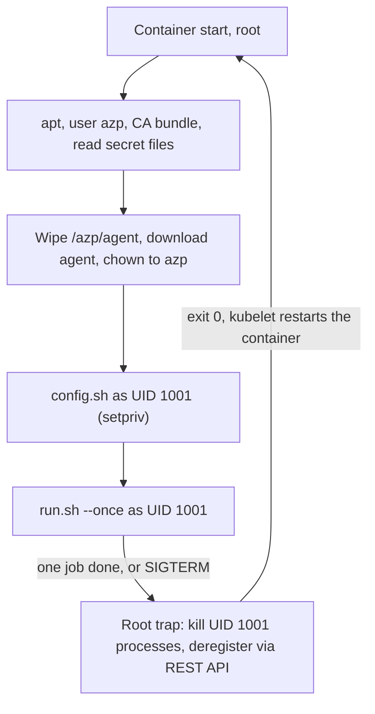
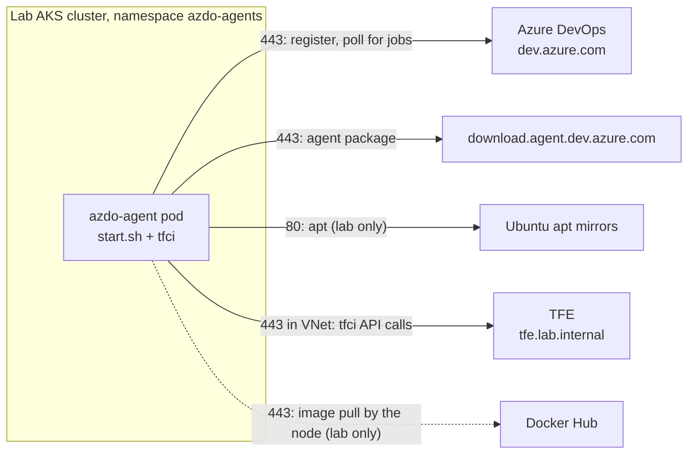

# Lab Azure DevOps agent on AKS

## Purpose

A self-hosted Azure DevOps agent that runs as a pod in the existing lab AKS cluster, namespace `azdo-agents`. It runs the v2 pipelines in **native** mode: `tfci` is on the PATH and no Docker is needed. It reaches TFE privately at `https://tfe.lab.internal` with the lab CA, and polls Azure DevOps outbound. Nothing calls in.

This is lab-only. See [Production differences](#production-differences).

| File | What it is |
| --- | --- |
| `namespace.yaml` | Namespace `azdo-agents`. Pod Security `baseline` enforced, `restricted` as a warning. |
| `configmap-start.yaml` | Microsoft's Linux `start.sh` from [Run a self-hosted agent in Docker](https://learn.microsoft.com/azure/devops/pipelines/agents/docker), adapted for a PAT file, a root supervisor and a UID 1001 agent that takes one job per start. |
| `deployment.yaml` | One replica. An init container copies `tfci` from `hashicorp/tfci:v1.4.0`; the `ubuntu:24.04` container runs `start.sh`, which installs the packages, then runs the agent as UID 1001. |

## Why a pod

No new VM, so no new compute for EDR (HC-COMPUTE-011). The pod runs on the existing lab nodes (`aks-default-*`), which are already tracked. No nodeSelector or toleration is needed.

## Prerequisites (David does these)

1. An Azure DevOps organisation and project.
2. An agent pool named `lab-aks` (Organisation settings, Agent pools).
3. A PAT with scope **Agent Pools (Read & manage)** only, and a short expiry.
4. The namespace and the secret. Read the PAT with `read -s` so it is not echoed and does not land in shell history:

   ```bash
   export KUBECONFIG=$HOME/.kube/lab.config
   kubectl apply -f lab/azdo-agent/namespace.yaml

   read -r  -p "Azure DevOps org URL (https://dev.azure.com/<org>): " AZP_URL_IN
   read -rs -p "Agent PAT: " AZP_PAT_IN; echo
   kubectl -n azdo-agents create secret generic azdo-agent \
     --from-literal=url="$AZP_URL_IN" \
     --from-literal=pool=lab-aks \
     --from-literal=token="$AZP_PAT_IN"
   unset AZP_PAT_IN AZP_URL_IN
   ```

   The command line holds `$AZP_PAT_IN`, not the PAT, so history stays clean.

## The CA ConfigMap

The agent trusts the lab TFE CA from ConfigMap `tfe-ca`, key `ca.pem`. The pem is in the lab repo at `examples/cli/02-app/tfe-ca.pem`. From the lab repo root:

```bash
kubectl -n azdo-agents create configmap tfe-ca \
  --from-file=ca.pem=examples/cli/02-app/tfe-ca.pem
```

At start the container builds `/etc/azp-ca/bundle.pem` (the Ubuntu public roots plus the lab CA), root-owned and mode 0444, and `SSL_CERT_FILE` and `NODE_EXTRA_CA_CERTS` point at it. Go's TLS reads `SSL_CERT_FILE`, so `tfci` trusts the lab CA without touching the system store. The bundle keeps the public roots because curl and the agent also read `SSL_CERT_FILE`, and need them to reach Azure DevOps. The lab CA alone is mounted at `/etc/tfe-ca/ca.pem`, which is the path to give the pipelines' `caBundle` parameter.

## Apply order

```bash
export KUBECONFIG=$HOME/.kube/lab.config
kubectl apply -f lab/azdo-agent/namespace.yaml          # skip if done above
# secret azdo-agent and configmap tfe-ca, as above
kubectl apply -f lab/azdo-agent/configmap-start.yaml
kubectl apply -f lab/azdo-agent/deployment.yaml
```

## Start sequence

`start.sh` runs as root, as PID 1, and does only setup and supervision:

1. `set -euo pipefail`, then `apt-get install` the agent's packages (lab only).
2. Create user `azp`, UID 1001, home `/home/azp`.
3. Build `/etc/azp-ca/bundle.pem`: root-owned, 0444, in a root-owned 0755 directory.
4. Read `url`, `pool` and `token` from the secret volume at `/etc/azp-secret` (root-owned, 0400). The PAT goes into an unexported shell variable and is never echoed.
5. Wipe `/azp/agent`, including `_work`, download and extract the agent there, then `chown -R azp:azp /azp/agent`.
6. Export `PATH` (with `/opt/tools/bin` for `tfci`), then configure the agent as `azp` through `setpriv`: UID and GID 1001, empty capability bounding set, `no_new_privs`.
7. Run `./run.sh --once` as `azp`, as a child of the root shell, and wait. The agent takes one job, then exits.
8. An `EXIT` trap in the root shell stops the agent if it is still running, kills any leftover UID 1001 process, keeps killing until none remain, then deregisters the agent through the Azure DevOps REST API from the root shell (pool and agent looked up by name, PAT on curl's stdin, up to 10 retries), and exits 0. No agent code runs while the PAT is in use, because jobs can write the agent's files.

The kubelet restarts the container and the sequence starts again at step 1. Each job gets a freshly registered agent and a clean work directory.



## Security model

**What is protected, and from whom.** The threat is pipeline job code: a PR, a task or a script that runs on this agent. Jobs run as UID 1001 with no capabilities, an empty bounding set and `no_new_privs`, so they cannot get root back.

| Asset | Protection |
| --- | --- |
| The PAT | A file in a root-owned 0400 secret volume, held in an unexported variable of the root shell. It is not in any process environment, so `/proc/*/environ` does not show it, and UID 1001 cannot read the file or root's memory. |
| The CA bundle | `/etc/azp-ca/bundle.pem`, root-owned 0444 in a root-owned 0755 directory. A job cannot add a CA or swap the bundle. |
| `tfci` | `/opt/tools/bin` is mounted read-only. A job cannot replace the binary. |
| Agent binaries and `_work` | Owned by `azp`, so a job can change them, but only for its own run: `--once` ends the agent after one job and the next start wipes `/azp/agent`. Nothing carries over to the next job. |

**Residual risks.**

- The agent's own OAuth credential, `/azp/agent/.credentials` and `.credentials_rsaparams`, is readable by jobs because they run as the same user as the agent. This is inherent to any self-hosted agent. It lets a job act as this agent until the registration is removed at the end of the job.
- The container restarts; the pod is not recreated. The `/azp` emptyDir therefore persists across restarts, which is why `start.sh` wipes `/azp/agent` at every start.
- The PAT is in `config.sh`'s argv while it configures the agent, which is what Microsoft's own script does. That happens right after a fresh extract, before any job runs. Removal does not run agent code at all: it is a REST call from the root shell with the PAT on stdin.
- The kubelet applies its restart back-off to clean exits too, so the gap between jobs can grow to a few minutes when jobs are short and frequent.
- The container itself still starts as root with a few capabilities, and apt runs at every start. Both go away with a baked image.

## Check the agent is online

```bash
kubectl -n azdo-agents rollout status deploy/azdo-agent
kubectl -n azdo-agents logs deploy/azdo-agent -c agent -f
```

The log shows steps 1 to 6 of `start.sh`, then `Listening for Jobs`. After each job the agent deregisters, the container restarts and the agent registers again; the pod's restart count goes up by one per job. In Azure DevOps, open Organisation settings, Agent pools, `lab-aks`, Agents: the agent is named after the pod and shows **Online**.

Check `tfci`, the CA and the job user from inside the pod. The `setpriv` line runs the check as UID 1001, as a job would:

```bash
kubectl -n azdo-agents exec deploy/azdo-agent -c agent -- \
  setpriv --reuid=1001 --regid=1001 --init-groups --bounding-set=-all --no-new-privs \
  bash -c 'id; export PATH=/opt/tools/bin:$PATH; command -v tfci && curl -sS -o /dev/null -w "%{http_code}\n" https://tfe.lab.internal/api/v1/health/readiness; cat /etc/azp-secret/token >/dev/null 2>&1 && echo "FAIL: token readable" || echo "OK: token not readable"'
```

## Remove it

Delete the Deployment first, so `start.sh` deregisters the agent from the pool on SIGTERM, then the rest. A running job gets up to 60 seconds to stop:

```bash
kubectl -n azdo-agents delete deploy/azdo-agent --wait
kubectl delete namespace azdo-agents
```

If the pod was killed before it deregistered, remove the offline agent by hand in the `lab-aks` pool. Then revoke the PAT.

## Outbound connections

Everything is outbound on 443. Nothing needs an inbound rule.

| Destination | Why | Source |
| --- | --- | --- |
| `dev.azure.com`, `*.dev.azure.com` | Agent registration, job polling, logs, repo checkout | Microsoft, [Allowed IP addresses and domain URLs](https://learn.microsoft.com/azure/devops/organizations/security/allow-list-ip-url) (page dated 2026-02-10, checked 2026-11-15) |
| `download.agent.dev.azure.com` | Agent package download. It replaced `vstsagentpackage.azureedge.net`; Microsoft asks for `*.dev.azure.com`, or this host if wildcards are not allowed | Same page, "CDN Domain URL change for Agents in Pipelines" |
| `login.microsoftonline.com`, `*.vssps.visualstudio.com`, `*.vsblob.visualstudio.com` | Sign-in and token services, artifact blobs. On Microsoft's common list; whether a PAT-only agent needs all of them is not tested here | Same page |
| `archive.ubuntu.com`, `security.ubuntu.com` (port 80) | apt at start. **Lab only** | Ubuntu default sources in `ubuntu:24.04` |
| Docker Hub (`registry-1.docker.io`, `auth.docker.io`, `production.cloudflare.docker.com`) | Pulls `hashicorp/tfci` and `ubuntu`. Pulled by the node, not the pod. **Lab only**: mirror to an internal registry for production | Docker documentation |
| `tfe.lab.internal` on 443, inside the VNet | TFE API calls from `tfci` | Lab design |



## Production differences

- Bake the agent image, with the agent, its packages and `tfci`, into an internal registry. No apt and no package download at start.
- Pin every image by digest, not tag.
- Run as a non-root user from the start: `runAsNonRoot: true`, drop all capabilities, read-only root filesystem where the agent allows. No root supervisor is needed, and the namespace can enforce `restricted`.
- **Use separate agent pools for PR validation and for apply pipelines.** PR code is untrusted; it must never run on an agent that holds apply credentials or can reach production workspaces.
- One pod per job: KEDA's Azure Pipelines scaler, or Managed DevOps Pools. Each job then gets a new pod, not a restarted container, and no emptyDir carries over.
- A PAT scoped to **Agent Pools (Read & manage)** only, with a short expiry. Better still, register with a service principal or managed identity instead of a PAT.
- For Docker mode, use Managed DevOps Pools or VM scale-set agents, not pods. A pod would need a Docker socket or privileged mode, which this design avoids.
- Mirror the init image (`hashicorp/tfci`) internally rather than pulling from Docker Hub.
