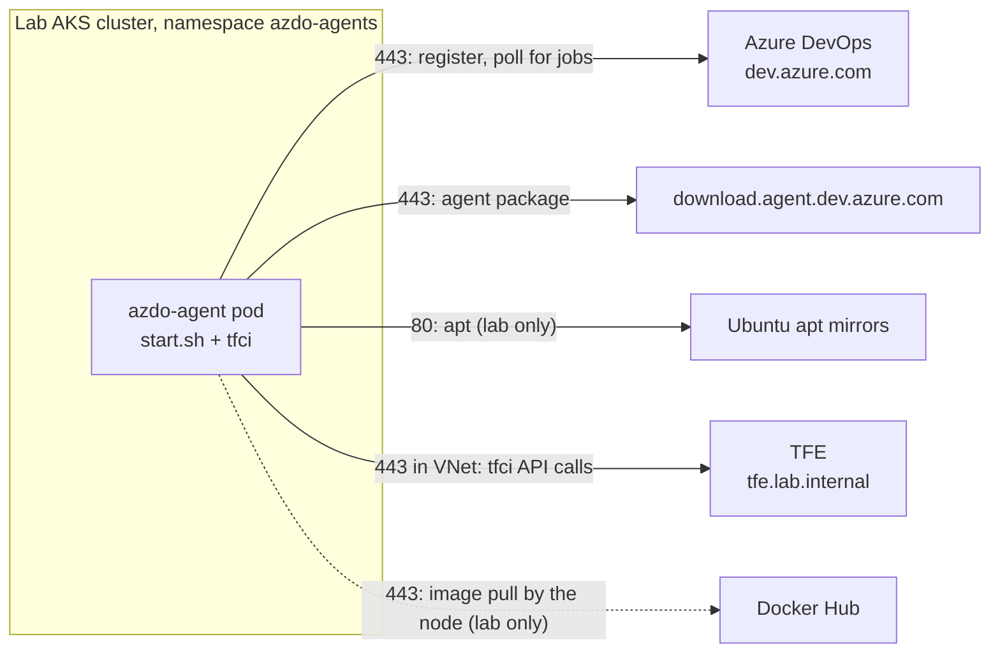

# Lab Azure DevOps agent on AKS

## Purpose

A self-hosted Azure DevOps agent that runs as a pod in the existing lab AKS cluster, namespace `azdo-agents`. It runs the v2 pipelines in **native** mode: `tfci` is on the PATH and no Docker is needed. It reaches TFE privately at `https://tfe.lab.internal` with the lab CA, and polls Azure DevOps outbound. Nothing calls in.

This is lab-only. See [Production differences](#production-differences).

| File | What it is |
| --- | --- |
| `namespace.yaml` | Namespace `azdo-agents`. Pod Security `baseline` enforced, `restricted` as a warning. |
| `configmap-start.yaml` | Microsoft's Linux `start.sh` from [Run a self-hosted agent in Docker](https://learn.microsoft.com/azure/devops/pipelines/agents/docker), adapted for a PAT and a read-only mount. |
| `deployment.yaml` | One replica. An init container copies `tfci` from `hashicorp/tfci:v1.4.0`; the `ubuntu:24.04` container installs the agent's packages and runs `start.sh`. |

## Why a pod

No new VM, so no new compute for EDR (HC-COMPUTE-011). The pod runs on the existing lab nodes (`aks-default-*`), which are already tracked. No nodeSelector or toleration is needed.

## Prerequisites (David does these)

1. An Azure DevOps organisation and project.
2. An agent pool named `lab-aks` (Organisation settings, Agent pools).
3. A PAT with scope **Agent Pools (Read & manage)** only, and a short expiry.
4. The namespace and the secret. Read the PAT with `read -s` so it is not echoed and does not land in shell history:

   ```bash
   export KUBECONFIG=$HOME/.kube/lab.config
   kubectl apply -f lab/azdo-agent/namespace.yaml

   read -r  -p "Azure DevOps org URL (https://dev.azure.com/<org>): " AZP_URL_IN
   read -rs -p "Agent PAT: " AZP_PAT_IN; echo
   kubectl -n azdo-agents create secret generic azdo-agent \
     --from-literal=url="$AZP_URL_IN" \
     --from-literal=pool=lab-aks \
     --from-literal=token="$AZP_PAT_IN"
   unset AZP_PAT_IN AZP_URL_IN
   ```

   The command line holds `$AZP_PAT_IN`, not the PAT, so history stays clean.

## The CA ConfigMap

The agent trusts the lab TFE CA from ConfigMap `tfe-ca`, key `ca.pem`. The pem is in the lab repo at `examples/cli/02-app/tfe-ca.pem`. From the lab repo root:

```bash
kubectl -n azdo-agents create configmap tfe-ca \
  --from-file=ca.pem=examples/cli/02-app/tfe-ca.pem
```

At start the container builds `/azp/ca-bundle.pem` (the Ubuntu public roots plus the lab CA) and `SSL_CERT_FILE` points at it. Go's TLS reads `SSL_CERT_FILE`, so `tfci` trusts the lab CA without touching the system store. The bundle keeps the public roots because curl and the agent also read `SSL_CERT_FILE`, and need them to reach Azure DevOps. The lab CA alone is mounted at `/etc/tfe-ca/ca.pem`, which is the path to give the pipelines' `caBundle` parameter.

## Apply order

```bash
export KUBECONFIG=$HOME/.kube/lab.config
kubectl apply -f lab/azdo-agent/namespace.yaml          # skip if done above
# secret azdo-agent and configmap tfe-ca, as above
kubectl apply -f lab/azdo-agent/configmap-start.yaml
kubectl apply -f lab/azdo-agent/deployment.yaml
```

## Check the agent is online

```bash
kubectl -n azdo-agents rollout status deploy/azdo-agent
kubectl -n azdo-agents logs deploy/azdo-agent -c agent -f
```

The log shows steps 1 to 4 of `start.sh`, then `Listening for Jobs`. In Azure DevOps, open Organisation settings, Agent pools, `lab-aks`, Agents: the agent is named after the pod and shows **Online**.

Check `tfci` and the CA from inside the pod:

```bash
kubectl -n azdo-agents exec deploy/azdo-agent -c agent -- bash -c \
  'command -v tfci && curl -sS -o /dev/null -w "%{http_code}\n" https://tfe.lab.internal/api/v1/health/readiness'
```

## Remove it

Delete the Deployment first, so `start.sh` deregisters the agent from the pool on SIGTERM, then the rest:

```bash
kubectl -n azdo-agents delete deploy/azdo-agent --wait
kubectl delete namespace azdo-agents
```

If the pod was killed before it deregistered, remove the offline agent by hand in the `lab-aks` pool. Then revoke the PAT.

## Outbound connections

Everything is outbound on 443. Nothing needs an inbound rule.

| Destination | Why | Source |
| --- | --- | --- |
| `dev.azure.com`, `*.dev.azure.com` | Agent registration, job polling, logs, repo checkout | Microsoft, [Allowed IP addresses and domain URLs](https://learn.microsoft.com/azure/devops/organizations/security/allow-list-ip-url) (page dated 2026-02-10, checked 2026-11-15) |
| `download.agent.dev.azure.com` | Agent package download. It replaced `vstsagentpackage.azureedge.net`; Microsoft asks for `*.dev.azure.com`, or this host if wildcards are not allowed | Same page, "CDN Domain URL change for Agents in Pipelines" |
| `login.microsoftonline.com`, `*.vssps.visualstudio.com`, `*.vsblob.visualstudio.com` | Sign-in and token services, artifact blobs. On Microsoft's common list; whether a PAT-only agent needs all of them is not tested here | Same page |
| `archive.ubuntu.com`, `security.ubuntu.com` (port 80) | apt at start. **Lab only** | Ubuntu default sources in `ubuntu:24.04` |
| Docker Hub (`registry-1.docker.io`, `auth.docker.io`, `production.cloudflare.docker.com`) | Pulls `hashicorp/tfci` and `ubuntu`. Pulled by the node, not the pod. **Lab only**: mirror to an internal registry for production | Docker documentation |
| `tfe.lab.internal` on 443, inside the VNet | TFE API calls from `tfci` | Lab design |



## Production differences

- Bake the agent image, with the agent, its packages and `tfci`, into an internal registry. No apt and no package download at start.
- Pin every image by digest, not tag.
- Run as a non-root user: `runAsNonRoot: true`, drop all capabilities, read-only root filesystem where the agent allows. Then the namespace can enforce `restricted`.
- Mount the PAT as a file and set `AZP_TOKEN_FILE`, so it is never in the container environment. Better still, register with a service principal or managed identity instead of a PAT.
- For Docker mode, use Managed DevOps Pools or VM scale-set agents, not pods. A pod would need a Docker socket or privileged mode, which this design avoids.
- Mirror the init image (`hashicorp/tfci`) internally rather than pulling from Docker Hub.
